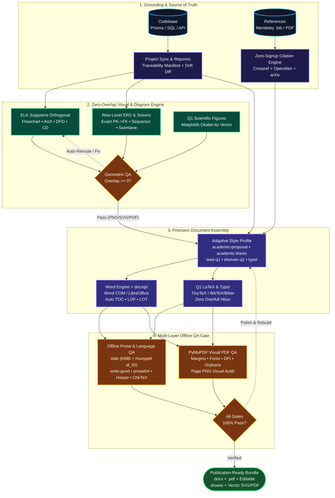

<div align="center">

# 📄 DOC-STUDIO
### *100% Free, Zero-Signup, Portable Precision Document, Academic Thesis, Q1 Journal Paper, Zero-Overlap Draw.io Diagram & Offline Prose QA MCP Studio*

[](https://github.com/Muhammad-Rizqullah-Akbar)
[](LICENSE)
[](https://www.python.org/)
[](https://modelcontextprotocol.io/)
[](THIRD_PARTY_NOTICES.md)
[](CONTRIBUTING.md)

<p align="center">
  
</p>

[Why Doc-Studio](#-why-doc-studio) • [Architecture](#-system-architecture--closed-loop-pipeline) • [Key Features](#-key-features) • [Quickstart](#-quickstart-3-minute-setup) • [12 MCP Tools](#-complete-12-mcp-tool-reference) • [Style Profiles & Sources](#-style-profiles--authoritative-upstream-sources) • [CLI Reference](#-cli-command-reference) • [Contributing](#-community-contributing--roadmap)

---
</div>

> [!NOTE]
> **AI-Assisted Documentation:** Dokumentasi `README.md` ini disusun bersama AI berdasarkan struktur kode aktual, modul MCP, profil gaya, template, dan rangkaian pengujian terverifikasi di dalam repositori ini.

> [!IMPORTANT]
> **100% Free, Zero-Signup, Local-First Publishing Studio:** Doc-Studio mengubah AI coding agent (Antigravity, Claude Code, Cursor, Codex, atau klien MCP lainnya) menjadi mesin penulisan dokumen dan diagram teknis berpresisi tinggi untuk **Proposal, Laporan Teknis, Skripsi/Tugas Akhir, Dokumentasi Arsitektur, hingga Paper Jurnal Q1 (IEEE, Elsevier, Springer LNCS)**. Seluruh pipeline berjalan lokal di mesinmu tanpa API key berbayar, tanpa unggah naskah ke server pihak ketiga, dan tetap sinkron otomatis setiap kali codebase mengalami perombakan.

---

## 🎯 Why Doc-Studio?

Menulis dokumen formal dan diagram teknis berbantu AI biasanya gagal di 5 titik krusial:
1. **Diagram Berantakan & Salah Tunjuk:** Garis panah tumpang tindih menembus kotak, relasi ERD hanya menunjuk kotak tabel (bukan baris kolom PK -> FK spesifik), atau DFD melanggar aturan aliran data baku.
2. **Formatting & Layout Rapuh:** Margin meleset, font tidak konsisten, caption gambar terpisah ke halaman berikutnya, tabel terbelah di tengah baris, serta Daftar Isi / Daftar Gambar / Daftar Tabel tidak sinkron dengan nomor halaman PDF.
3. **Bahasa Kaku & Tidak Baku:** Naskah penuh klise AI (*AI-slop*), kata tidak baku KBBI/EYD V pada dokumen Bahasa Indonesia, atau grammar halus & typo tipografi LaTeX pada paper Q1 Bahasa Inggris.
4. **Sitasi Halusinasi:** AI sering mengarang DOI, tahun terbit, atau mengutip paper yang sudah diretraksi (*retracted*).
5. **Doc-Drift Setelah Refactor:** Ketika skema database atau endpoint API dirombak, diagram dan bab dokumentasi cepat tertinggal dari implementasi nyata.

**Doc-Studio** menyelesaikan kelimanya melalui satu plugin MCP portable (**12 native tools** + integrasi **Repomix MCP** & **Official `@drawio/mcp`**) serta CLI 1-perintah lintas OS.

---

## 🏗️ System Architecture & Closed-Loop Pipeline



---

## 🌟 Key Features

- 📐 **Zero-Overlap Draw.io Diagram Engine:** Routing ortogonal Sugiyama via `elkjs`, snapping sudut rhombus, solver deterministik **Sequence Diagram (`sd`)** & **Swimlane (`ufd`/`swimlane`)**, validasi geometris anti-tabrakan (`node_overlap == 0`, `edge_crosses_node == 0`), plus dukungan palet **`monochrome-bw`** hitam-putih bersih dan `ieee-q1`.
- 🔗 **Row-Level ERD & Semantic DFD Guard:** Relasi ERD menunjuk tepat ke **sel baris PK -> FK** (termasuk jalur ortogonal 90 derajat bertingkat untuk dual-FK di antara dua tabel yang sama) dengan *fail-loud validation* jika nama kolom tidak cocok. DFD menolak otomatis aliran ilegal (*external -> store* / *store -> store*) tanpa melewati proses.
- 📝 **Precision Word (`.docx` -> PDF) Engine:** Profil adaptif (`academic-proposal`, `academic-thesis`, `tech-report-modern`, atau *JSON override* bebas), penomoran halaman ganda Romawi (`i, ii`) & Arab (`1, 2`), auto-height cap gambar agar caption tidak pernah pindah halaman, tabel `colspan`/`rowspan` dengan `w:tblHeader` + `w:cantSplit`, kotak `callout`, `signature_grid` (Lembar Pengesahan), persamaan matematika OMML, injeksi template `.docx` resmi institusi via `docxtpl`, serta **Word COM `Fields.Update()`** otomatis (dengan fallback LibreOffice headless di Linux/macOS).
- 🎓 **Q1 Academic Paper & Vector Figure Suite:** Template siap compile **IEEE Transactions (`IEEEtran`)**, **Elsevier (`elsarticle`)**, **Springer LNCS**, dan **Typst** modern, lengkap dengan generator grafik ilmiah **Matplotlib** (lebar kolom IEEE/Elsevier presisi, TrueType font embed, palet colorblind-safe Okabe-Ito, PDF/SVG/600 DPI PNG).
- 📚 **Authoritative Offline Prose QA (Indonesian & English):**
  - **Bahasa Indonesia Baku:** 1.413 pasang kata tidak baku -> baku dari `lantip/baku-tidak-baku` (KBBI & Ivan Lanin) + kamus resmi Hunspell **`LibreOffice/dictionaries` (`id_ID`)** via `Vale`, plus deteksi pleonasme & klise AI Indonesia.
  - **Bahasa Inggris Q1:** Paket resmi `errata-ai` Vale (**`write-good`**, **`proselint`**, **`Google`**) + **`Harper CLI`** (Rust offline grammar) + **`ChkTeX`** (tipografi LaTeX).
  - **Hygiene & Overlap Lokal:** Pembersih karakter Unicode tak terlihat (`U+200B/C/D`, `U+FEFF`), analisis ritme kalimat (*burstiness*), dan cek kemiripan 5-gram lokal terhadap file referensi milikmu sendiri.
- 🔍 **Zero-Signup Citation Verifier & Mendeley `.bib` Bridge:** Baca langsung file `.bib` ekspor Mendeley Reference Manager atau Zotero, verifikasi DOI/judul/tahun/status retraksi ke **Crossref & OpenAlex**, serta cari 270 juta+ paper ilmiah via **OpenAlex & arXiv** tanpa akun maupun API key.
- 🔄 **Living Project Sync:** Pindai otomatis skema **Prisma**, **SQL DDL (`CREATE TABLE`)**, **OpenAPI/Swagger JSON**, serta rute **NestJS / FastAPI / Express** menjadi manifest traceability + deteksi *drift* setelah refactor.

---

## 🚀 Quickstart (3-Minute Setup)

### Prasyarat
- **Python >= 3.10** (disarankan `uv` terpasang) & **Node.js >= 18**
- **Draw.io Desktop** (untuk render PNG/SVG/PDF headless) & **Pandoc** (untuk konversi sitasi CSL & OMML)
- *(Opsional untuk PDF Word/LaTeX)* Microsoft Word (Windows) atau LibreOffice (Linux/macOS), serta TinyTeX/TeX Live untuk kompilasi LaTeX Q1.

### 1. Clone & Jalankan 1-Command Installer

**Windows (PowerShell):**
```powershell
git clone https://github.com/Muhammad-Rizqullah-Akbar/doc-studio.git
cd doc-studio
powershell -ExecutionPolicy Bypass -File scripts/install.ps1
```

**macOS / Linux:**
```bash
git clone https://github.com/Muhammad-Rizqullah-Akbar/doc-studio.git
cd doc-studio
bash scripts/install.sh
```

Installer otomatis membuat `.venv`, memasang `elkjs`, `repomix`, `@drawio/mcp`, mengunduh biner portable (`Vale`, `Harper CLI`, `Typst`), 6 style CSL resmi, kamus Hunspell `LibreOffice id_ID`, dataset KBBI `lantip/baku-tidak-baku`, menyinkronkan paket `errata-ai` Vale (`write-good`, `proselint`, `Google`), dan menghasilkan `mcp_config.json` sesuai mesin lokalmu.

### 2. Hubungkan ke AI Coding Agent
- **Antigravity IDE:** Salin atau symlink folder repo ke `~/.gemini/config/plugins/doc-studio`, aktifkan `"doc-studio": { "enabled": true }` di `~/.gemini/config/config.json`, lalu reload sesi.
- **Claude Code / Cursor / Codex / MCP Client Lainnya:** Impor isi `mcp_config.json` yang dihasilkan installer ke konfigurasi MCP klienmu.

---

## 🛠️ Complete 12 MCP Tool Reference

Selain companion server **`repomix`** (6 tools) dan **`drawio`** (`@drawio/mcp`, 8 tools), server `doc-studio` mengekspos **12 tool modular**:

| # | Tool Name | Fungsi Utama |
|---|---|---|
| 1 | `list_style_profiles` | Daftar profil dokumen/diagram + status biner & CSL lokal |
| 2 | `generate_drawio_diagram` | Generate `.drawio` zero-overlap (ELK orthogonal / SD / Swimlane / Row-Level ERD / Semantic DFD) + render PNG/SVG/PDF |
| 3 | `validate_and_render_drawio` | Validasi geometris anti-overlap & render file `.drawio` mana pun |
| 4 | `build_word_document` | Bangun `.docx` presisi (`colspan`/`rowspan`, callout, signature grid, OMML, CSL) + finalisasi Word COM / LibreOffice Auto-TOC/LOF/LOT -> PDF |
| 5 | `render_docx_template` | Isi template `.docx` resmi institusi/kampus via `docxtpl` + ekspor PDF |
| 6 | `build_latex_or_typst_pdf` | Scaffold & compile paper Q1 LaTeX (TinyTeX + BibTeX/Biber + cek overfull hbox) atau Typst |
| 7 | `build_q1_figure_chart` | Grafik ilmiah Matplotlib Q1 (Okabe-Ito colorblind-safe, TrueType embed, PDF/SVG/600 DPI PNG) |
| 8 | `qa_inspect_pdf` | Audit PDF PyMuPDF (margin, font, DPI gambar, blank page, orphan heading, broken ref) + render PNG halaman |
| 9 | `sync_project_docs_manifest` | Ekstraksi deterministik Prisma/SQL ERD, rute API/OpenAPI, modul, dan *drift diff* pasca refactor |
| 10 | `audit_prose_and_hygiene` | Audit 100% offline: Vale (KBBI/Hunspell `id_ID` atau `write-good`/`proselint`/`Google`), Harper, ChkTeX, Unicode sanitizer, burstiness, & local 5-gram overlap |
| 11 | `verify_bib_citations` | Verifikasi `.bib` (termasuk ekspor Mendeley/Zotero) terhadap Crossref & OpenAlex (DOI, judul, tahun, status retraksi) |
| 12 | `search_scholarly_papers` | Cari paper ilmiah asli di OpenAlex (270M+ karya) / arXiv tanpa API key dan ekspor BibTeX valid |

---

## 🎨 Style Profiles & Authoritative Upstream Sources

### Profil Dokumen Bawaan (`config/style_profiles.json`)
| Profile | Engine | Karakteristik Utama |
|---|---|---|
| `academic-proposal` | Word COM / LibreOffice | A4 (L4/R3/T3/B3 cm), Times New Roman 12pt, 1.15 spasi, tabel monokrom bersih, diagram `monochrome-bw`, auto Daftar Isi/Gambar/Tabel |
| `academic-thesis` | Word COM / LibreOffice | A4 (L4/R3/T4/B3 cm), 1.5 spasi, halaman Romawi (`i, ii`) + Arab (`1, 2`) beda halaman awal bab, tabel `booktabs`, APA 7 CSL |
| `ieee-q1` | LaTeX | IEEE Transactions 2 kolom (`IEEEtran`), `booktabs`, `microtype`, `overfull_hbox == 0` |
| `elsevier-q1` | LaTeX | Elsevier `elsarticle` preprint/journal template |
| `springer-lncs` | LaTeX | Springer LNCS-compatible geometry & typography |
| `tech-report-modern` | Typst | Kompilasi milidetik, header modern, tabel & outline otomatis |

### Sumber Upstream Terpercaya (Diunduh Otomatis Saat Install)
- **KBBI Kata Baku/Tidak Baku (1.413 pasang):** `lantip/baku-tidak-baku` (KBBI & Ivan Lanin)
- **Spellcheck Bahasa Indonesia:** `LibreOffice/dictionaries` (`id_ID.dic` & `id_ID.aff`)
- **Prose Linters Inggris:** `errata-ai/vale` (`write-good`, `proselint`, `Google`) + `Automattic/harper`
- **Style Sitasi (6 CSL):** `citation-style-language/styles` (`apa`, `ieee`, `springer-lncs`, `elsevier-harvard`, `elsevier-vancouver`, `acm-sig-proceedings`)
- **Database Sitasi Publik:** Crossref Public REST API, OpenAlex Public API, arXiv Public API

---

## 💻 CLI Command Reference

```bash
# Cek kesehatan seluruh 14 biner & 6 style CSL
.venv/Scripts/python engine/cli.py doctor

# Audit Bahasa Indonesia (KBBI 1.413 pasang + Hunspell id_ID + Pleonasme + AI-Slop)
.venv/Scripts/python engine/cli.py audit draft_thesis.docx --lang id --clean

# Audit Paper Q1 Inggris (write-good + proselint + Google + Harper + ChkTeX)
.venv/Scripts/python engine/cli.py audit paper_ieee.tex --lang en

# Verifikasi file .bib ekspor Mendeley/Zotero ke Crossref & OpenAlex (0 API key)
.venv/Scripts/python engine/cli.py verify-bib refs.bib

# Cari paper ilmiah asli dari OpenAlex dan tambahkan ke refs.bib
.venv/Scripts/python engine/cli.py search-papers "workflow state machine audit" --append-bib refs.bib

# Sinkronisasi codebase (Prisma / SQL / OpenAPI / NestJS / FastAPI) ke manifest traceability
.venv/Scripts/python engine/cli.py sync /path/to/project --out manifest.json

# Audit visual & struktural PDF + render PNG halaman
.venv/Scripts/python engine/cli.py qa Output_Final.pdf --profile academic-proposal --render-dir qa_pages
```

---

## 🤝 Community, Contributing & Roadmap

Proyek ini dikembangkan secara terbuka dan menerima kontribusi dari komunitas pengembang dan akademisi:

- 💡 **Diskusi Ide & Format Institusi Baru:** [GitHub Discussions](https://github.com/Muhammad-Rizqullah-Akbar/doc-studio/discussions)
- 🐛 **Pelaporan Masalah / Bug:** [GitHub Issues](https://github.com/Muhammad-Rizqullah-Akbar/doc-studio/issues)
- 📬 **Kontak Author:** `inirizqullahakbar@gmail.com`
- 🛠️ **Panduan Kontribusi:** Lihat [CONTRIBUTING.md](CONTRIBUTING.md)

### 🎯 Roadmap Pengembangan
- 📦 **PyPI & Homebrew Distribution:** Kemasan instalasi 1-baris `uv tool install doc-studio`.
- 🏫 **Community Academic Profile Pack:** Koleksi profil format tugas akhir/skripsi lintas universitas dan jurnal Q1 internasional (ACM, Nature, Springer).
- 🧪 **Automated CI Matrix:** GitHub Actions untuk pengujian lintas OS (Windows, macOS, Linux) pada setiap pull request.

---

## 📜 Lisensi & Atribusi

Didistribusikan di bawah lisensi **MIT License**. Hak Cipta (c) 2026 **Muhammad-Rizqullah-Akbar & Kontributor**. Lihat [LICENSE](LICENSE) dan [THIRD_PARTY_NOTICES.md](THIRD_PARTY_NOTICES.md) untuk rincian lisensi dan atribusi proyek open-source upstream.
